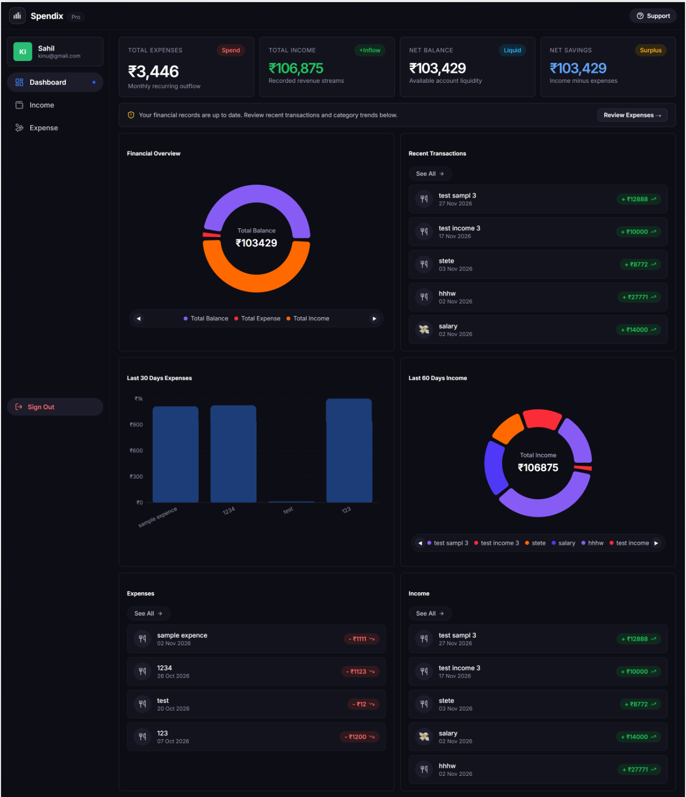
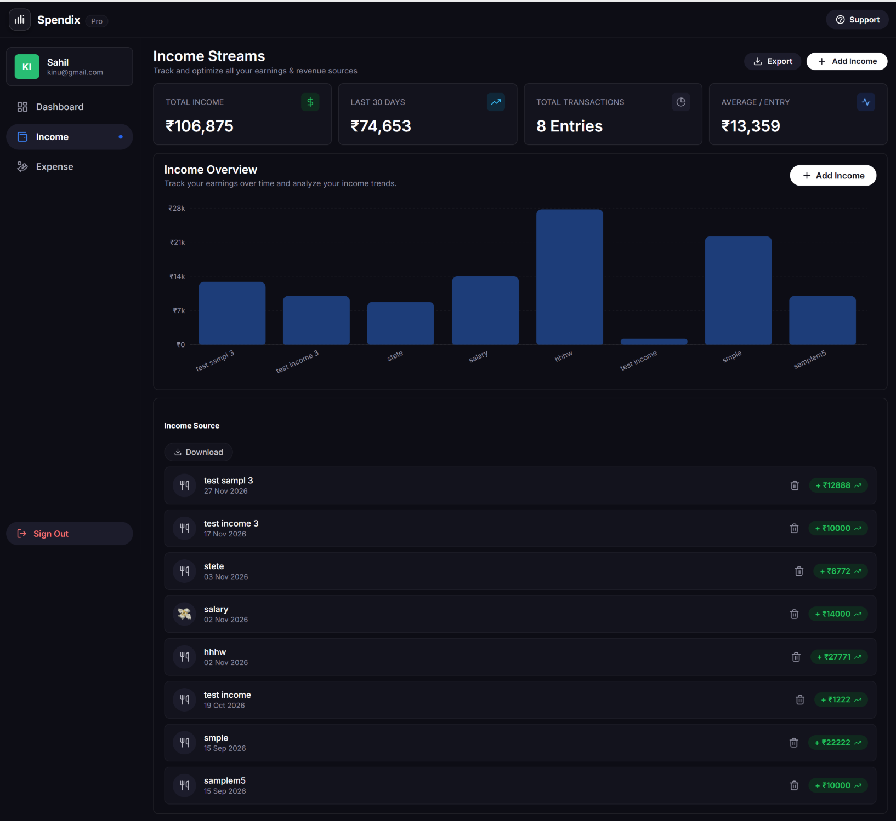
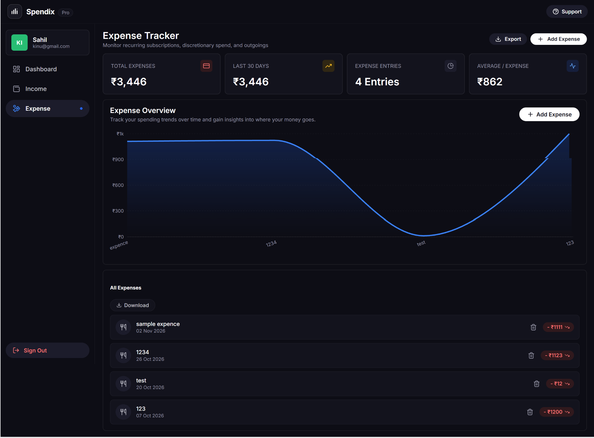
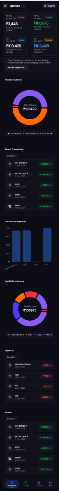

# 💸 Spendlix - Modern Expense Tracker & Financial Dashboard

Spendlix is a modern, responsive full-stack MERN application for tracking personal finances, visualizing income and expenses with interactive charts, and managing monthly budgets seamlessly across desktop and mobile devices.

---

## 📸 Screenshots & Previews

| View | Screenshot |
| :--- | :--- |
| **Main Dashboard**<br>_Overview, Balance cards, Recent transactions & Expense breakdown_ |  |
| **Income Management**<br>_Income sources, Category breakdown, and monthly analytics_ |  |
| **Expense Tracking**<br>_Categorized expenses, Trends, and detailed transaction history_ |  |
| **Mobile & Responsive View**<br>_PWA-ready mobile layout, quick actions, and touch-optimized navigation_ |  |

---

## 🚀 Key Features

- 📊 **Dynamic Financial Visualizations**: Interactive Bar charts, Line graphs, and Pie charts powered by Recharts.
- 💰 **Income & Expense Management**: Fast entry, categorized sorting, and real-time transaction updates.
- 📱 **Mobile-First & PWA-Ready**: Fully responsive layout tailored for mobile devices with an app-like navigation and touch feel.
- 🔐 **Secure JWT Authentication**: Protected routes with token-based session management and profile avatar personalization.
- 📑 **Excel Export**: Export transaction histories and statements directly to `.xlsx`.
- ⚡ **Vercel & Cloud Deployment**: Configured for seamless serverless deployment across frontend and backend.

---

## 🔧 Tech Stack

- **Client**: React 18, Vite, React Router, Recharts, Lucide Icons / React Icons, Tailwind CSS / Vanilla CSS
- **Server**: Node.js, Express.js
- **Database**: MongoDB (Mongoose ODM)
- **Authentication**: JSON Web Tokens (JWT) & bcrypt.js
- **File & Media Handling**: Multer (Avatar uploads)
- **Data Export**: XLSX

---

## 🗂️ Project Structure

```
Spendlix/
├── client/                     # Frontend application (React + Vite)
│   ├── public/                 # Static assets & PWA manifest / Service Worker
│   ├── src/
│   │   ├── assets/             # Images & static media
│   │   ├── components/         # Reusable UI components & layouts
│   │   │   ├── Cards/          # Info cards, avatars, metrics
│   │   │   ├── Charts/         # Recharts wrappers (Pie, Bar, Line)
│   │   │   ├── Dashboard/      # Dashboard widgets & summaries
│   │   │   ├── Expense/        # Expense forms, lists & views
│   │   │   ├── Income/         # Income forms, lists & views
│   │   │   ├── Inputs/         # Form inputs & photo picker
│   │   │   └── layouts/        # Navbar, SideMenu, Modals & Shells
│   │   ├── context/            # User & Auth Context
│   │   ├── hooks/              # Custom React hooks
│   │   ├── pages/              # Route pages (Dashboard, Income, Expense, Auth)
│   │   ├── utils/              # Axios instance, helpers & API constants
│   │   ├── App.jsx             # Root React component
│   │   └── index.css           # Global design tokens and styles
│   └── vite.config.js
│
├── server/                     # Backend REST API (Node + Express)
│   ├── config/                 # Database configuration (MongoDB connection)
│   ├── controllers/            # Controller business logic
│   ├── middleware/             # Auth & upload middlewares
│   ├── models/                 # Mongoose schemas (User, Income, Expense)
│   ├── routes/                 # Express API route endpoints
│   ├── server.js               # Express application entrypoint
│   └── vercel.json             # Vercel deployment configuration
│
└── Screenshots/                # Application preview images
    ├── dashboard.png
    ├── income.png
    ├── expence.png
    └── mobile.png
```

---

## ⚙️ Getting Started

### 1. Clone the repository

```bash
git clone https://github.com/Sahilmd01/Spendlix.git
cd Spendlix
```

### 2. Configure Environment Variables

#### Backend (`server/.env`)
Create a `.env` file inside the `server/` directory:

```env
PORT=5000
MONGO_URI=your_mongodb_connection_string
JWT_SECRET=your_jwt_secret_key
CLIENT_URL=http://localhost:5173
```

#### Frontend (`client/.env`)
Create a `.env` file inside the `client/` directory:

```env
VITE_API_BASE_URL=http://localhost:5000
```

---

### 3. Install Dependencies & Run Locally

#### Option A: Run from Project Root (Recommended)
You can launch both frontend and backend concurrently from the root:

```bash
# Install root & workspaces dependencies
npm install

# Run backend
npm run server

# Run frontend (in another terminal)
npm run client
```

#### Option B: Run Individually

##### Backend:
```bash
cd server
npm install
npm run dev
```

##### Frontend:
```bash
cd client
npm install
npm run dev
```

The frontend will run at `http://localhost:5173` and communicate with the backend at `http://localhost:5000`.

---

## 📝 License

Distributed under the MIT License. See `LICENSE` for more information.

Developed by [SAHIL](https://github.com/Sahilmd01)
